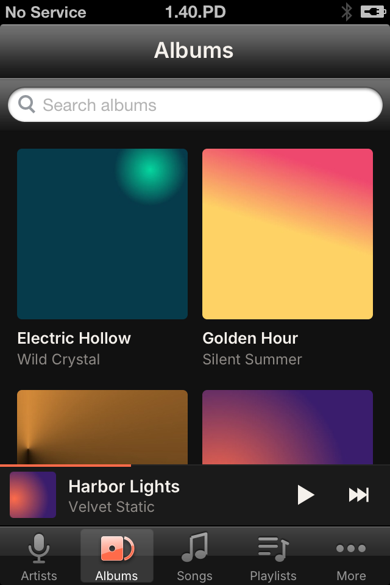
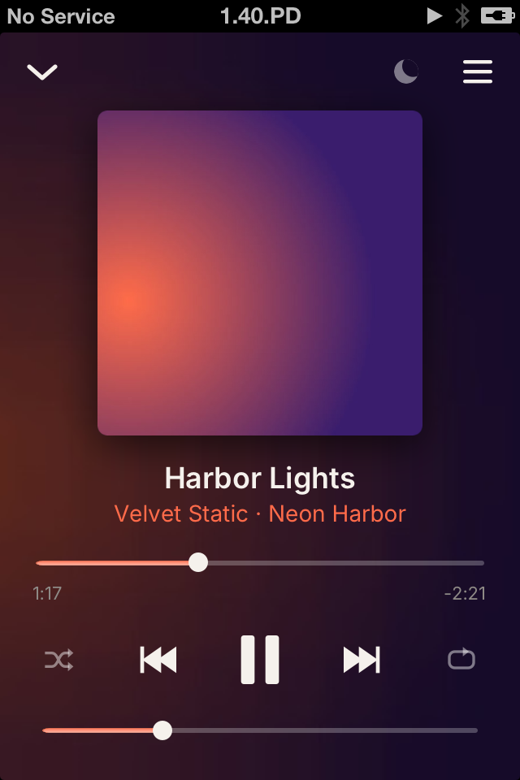
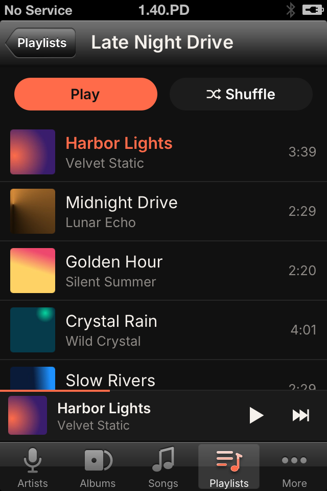

<div align="center">


### A music player for the iPhone 4S on iOS 6

_Native UIKit, gapless, light on the A5 chip_


[](LICENSE)
[](https://github.com/Stiven-Gjekaj/Groovelet/releases/latest)
[](https://ko-fi.com/stivengjekaj)

<p align="center">
  <a href="#overview"><b>Overview</b></a> |
  <a href="#install"><b>Install</b></a> |
  <a href="#put-music-on-the-phone"><b>Music</b></a> |
  <a href="#build"><b>Build</b></a> |
  <a href="docs/architecture.md"><b>Architecture</b></a> |
  <a href="TODO.md"><b>Roadmap</b></a>
</p>

</div>

---

> [!NOTE]
> **Version 1.0 is out.** It plays MP3, AAC, ALAC, WAV, AIFF, FLAC, Opus,
> Vorbis, APE, and WavPack with no gap between the tracks. It has a library
> of artists, albums, and songs, playlists, ReplayGain, and upload over
> Wi-Fi. [TODO.md](TODO.md) lists the known problems.
> [docs/decisions.md](docs/decisions.md) holds each decision and its reason.

---

<table>
<tr>
<td width="33%" valign="top">

<p align="center"><i>Your albums</i></p>
</td>
<td width="33%" valign="top">

<p align="center"><i>The player</i></p>
</td>
<td width="33%" valign="top">

<p align="center"><i>A playlist</i></p>
</td>
</tr>
</table>

## Overview

**Groovelet** plays the music on an iPhone 4S with iOS 6.1.3. It looks
modern, but it stays light and fast on the A5 chip. The lists with 10000
songs scroll at 60 frames each second, and the app uses 1.5% to 6.2% of one
core during play.

The app plays the files that you put on the phone. It does not read the
iPod library of iTunes, and it uses no network except the upload page on
your own Wi-Fi.

iOS 6 cannot play FLAC, Opus, Vorbis, APE, or WavPack. The app has an
audio-only build of FFmpeg for these formats, and it uses the decoders of
iOS for the others. All formats go through one audio output, so one track
goes into the next with no gap.
[docs/architecture.md](docs/architecture.md) tells how.

## Features

- Five tabs: Artists, Albums, Songs, Playlists, and More
- A grid of the album art, and a page for each album
- A search box at the top of each list, and an index of letters
- A mini player above the tabs, and a player screen with the art on a
  blurred copy of it
- Gapless play, shuffle, repeat all, and repeat one
- A queue: Play Next, Add to Queue, move, and remove
- Playlists that you make, M3U files, and the automatic playlists Recently
  Added, Most Played, and Recently Played
- ReplayGain from the tags, for each track or each album
- A sleep timer: 15, 30, or 45 minutes, 1 hour, or the end of the track
- The lock screen shows the art, and the headphone buttons work
- Play continues when the screen locks, and stops when the headphones come
  out
- AirPlay
- The queue and the place come back after a restart
- Upload over Wi-Fi, and "Open in Groovelet" from other apps
- Delete a track, an album, or a folder from the phone
- Folders, to see the files as they are on disk
- Open `groovelet://` links from other apps or a shell:
  `groovelet://play?path=PATH`, `groovelet://pause`, `groovelet://resume`,
  `groovelet://next`, `groovelet://previous`, `groovelet://seek?t=SECONDS`,
  `groovelet://sleep?t=SECONDS`, and `groovelet://open?name=albums`

Version 1.0.0 was checked on an iPhone 4S with iOS 6.1.3.

## Install

You need an iPhone, iPod touch, or iPad with iOS 6 and a jailbreak.

1. Download the `.deb` file from the
   [latest release](https://github.com/Stiven-Gjekaj/Groovelet/releases/latest).
2. Copy it to the phone, for example with `scp` to `/tmp/`.
3. On the phone, as root: `dpkg -i /tmp/io.github.stivengjekaj.groovelet_*.deb`.

The Groovelet icon comes on the home screen. To remove the app:
`dpkg -r io.github.stivengjekaj.groovelet`.

On iOS 7 or later, or with an APT that has TLS 1.2, you can also add the
Cydia source `https://stiven-gjekaj.github.io/cydia/`. Cydia then shows the
updates. Cydia on iOS 6 cannot read it, because its APT stops at TLS 1.0
and GitHub accepts only TLS 1.2. See
[the repository](https://github.com/Stiven-Gjekaj/cydia).

## Put music on the phone

The music is in `/var/mobile/Media/Groovelet`. Each folder and file there
shows in the app. The app reads the tags and the art in the files, or an
image named `cover`, `folder`, `front`, or `albumart` in the folder.

- **Over Wi-Fi:** open More, then Upload over Wi-Fi. Open the address that
  the screen shows in a browser on a computer on the same network, and drop
  files or folders on the page. The page works only while the screen is
  open.
- **Over USB:** copy the files into `Groovelet` with an AFC tool, for
  example iFunBox, iMazing, 3uTools, or `afcclient` of libimobiledevice.
  iTunes File Sharing does not show an app in `/Applications`.
- **From another app:** use "Open in Groovelet" in Mail, Safari, or another
  app. The file goes into `Imported`.
- **Over SSH:** `scp -r Album iphone4s:/var/mobile/Media/Groovelet/`

An M3U or M3U8 file in the music directory shows as a playlist.

## Build

You need a Mac with Xcode and the iOS 9.3 SDK of Theos.

1. Download `iPhoneOS9.3.sdk.tar.xz` from the releases of
   [theos/sdks](https://github.com/theos/sdks/releases) and unpack it into
   `sdks/`. The result is `sdks/iPhoneOS9.3.sdk`. Git does not track `sdks/`.
2. Run `./fix-sdk.sh` one time. It changes the SDK stubs for the new Apple
   linker and for iOS 6.
3. Build:

| Command | Result |
| ------- | ------ |
| `scripts/app.sh` | `build/Groovelet.app`. It builds FFmpeg first when necessary. |
| `scripts/deb.sh` | The Cydia package in `build/` |
| `scripts/test.sh` | The tests, on the Mac |
| `scripts/test.sh --phone` | The tests, on the phone, also the audio tests |
| `scripts/install.sh` | Builds the app, copies it to the phone, and opens it |
| `scripts/install.sh --debug` | The same, with the debug links of `src/ui/GLDebug.h` |
| `scripts/ffmpeg.sh` | The audio decoders of FFmpeg for the phone |
| `scripts/samples.sh` | Sample music in each format, copied to the phone |
| `scripts/bigsamples.py` | A library of many short files, to measure the speed |
| `scripts/icons.sh` | The icon, the launch images, and the tab icons |

The phone scripts use `ssh iphone4s`. Set up that host in `~/.ssh/config`,
for example with a USB tunnel of `iproxy` on port 2222.

`build.sh` builds one armv7 binary. It compiles with ARC and links without
ARC, and all code is in ARM mode (`-marm`). The new Apple linker makes Thumb
code that crashes on iOS 6 before `main` starts.

To run a tool on the phone:

```
./build.sh build/X probe/X.m -framework Foundation
scp build/X iphone4s:/tmp/
ssh iphone4s 'ldid -S /tmp/X && /tmp/X'
```

`probe/` holds three tools: `shot.m` saves a screenshot, `cpu.m` measures
the CPU use of a process, and `library.m` measures the queries of the
library. To play from a shell on the phone, use the `groovelet://` links
with `uiopen`.

## Support

If you find Groovelet useful, you can support its development here.

[](https://ko-fi.com/stivengjekaj)

## Licence

MIT. See [LICENSE](LICENSE). Groovelet uses FFmpeg under the LGPL 2.1 and the
Inter font under the SIL Open Font License 1.1. The texts are in
[licenses/](licenses).
